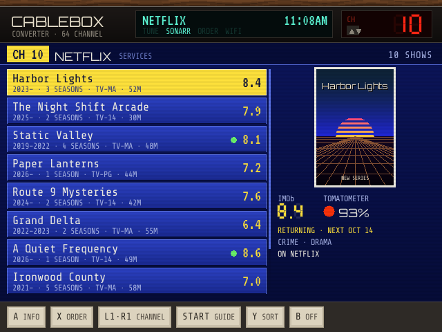
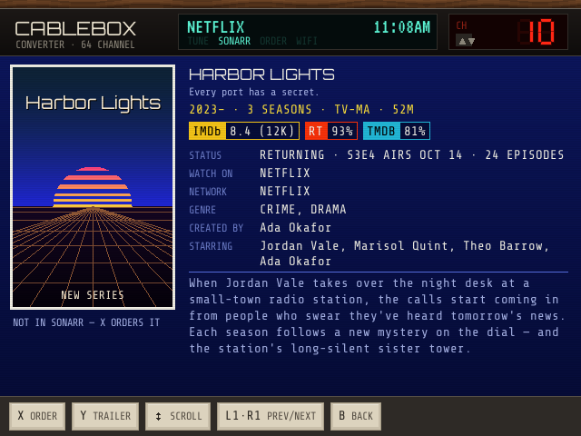
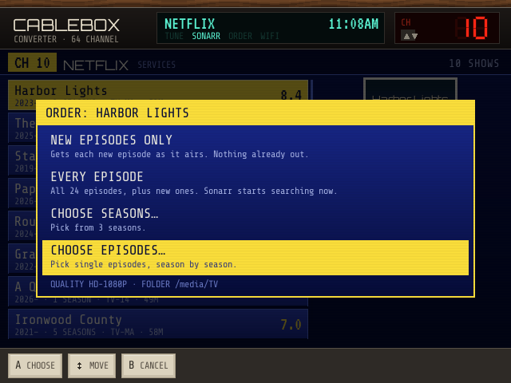
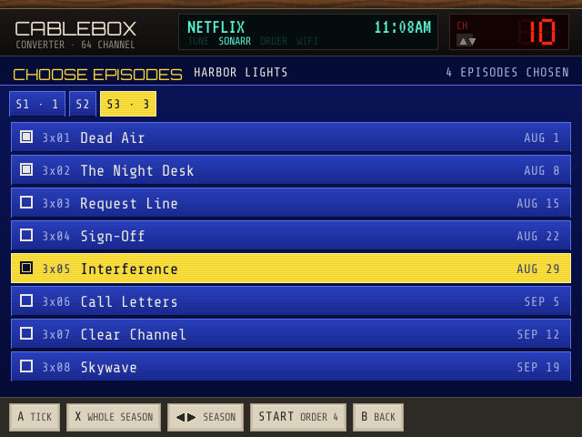
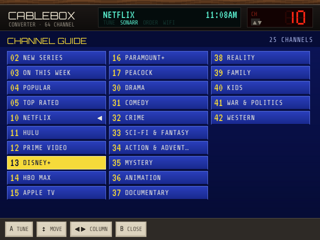
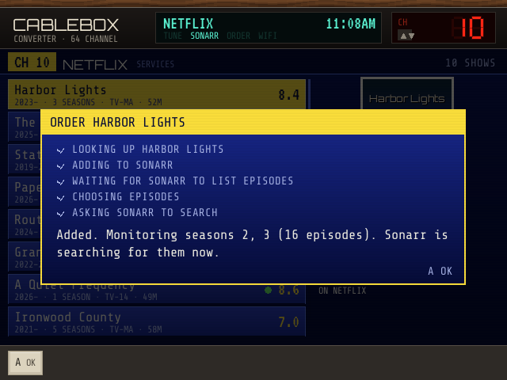

# CABLEBOX

**A TV guide that orders shows into Sonarr, for OnionOS on the Miyoo Mini Plus.** Cablebox lists TV shows on channels, like an 80s cable box tuned to the program guide: what's new, what's airing this week, what's popular, one channel per streaming service and one per genre. Every show has its IMDb rating, Rotten Tomatoes and Metacritic scores when they exist, seasons, cast, where it streams and a trailer you scan on your phone. Find one you want and order it: new episodes only, every episode, chosen seasons, or chosen episodes, and Sonarr does the rest.

> 🤖 **Built by Claude.** Cablebox was designed and written by [Claude](https://claude.ai), Anthropic's AI model, at the request of [@snyderman3000](https://github.com/snyderman3000). He came up with the idea and chose the direction. Claude wrote the code, the documentation and the artwork. It's the TV sibling of [Rewind](https://github.com/snyderman3000/rewind) and shares its engine with [Carrier](https://github.com/snyderman3000/Carrier-onionOS) and [Mixtape](https://github.com/snyderman3000/mixtape). Please report bugs through [Issues](https://github.com/snyderman3000/cablebox-onionOS/issues).

| | |
|---|---|
|  |  |
|  |  |
|  |  |

*Screenshots use invented shows, ratings and artwork.*

## Features

- **Search.** SELECT opens an on-screen keyboard: type part of a show's name and CH 01 tunes to the matches. Your last five searches are one press away.
- **Channels.** 02 NEW SERIES (premiered in the last four months), 03 ON THIS WEEK (new episodes in the past week), 04 POPULAR, 05 TOP RATED, then one channel per streaming service (Netflix, Hulu, Prime Video, Disney+, HBO Max, Apple TV, Paramount+, Peacock by default) and one per genre (Drama, Comedy, Crime, Sci-Fi & Fantasy, Mystery, Animation, Documentary, Reality and more). Everything listed streams on a subscription or free service in your region.
- **Channel surfing.** L1/R1 change channel with a burst of static, L2/R2 jump between the now/services/genres groups, START opens the full channel guide.
- **The details.** IMDb rating and vote count, Rotten Tomatoes and Metacritic when OMDb has them (less often for TV than for films), TMDB score, status and next air date, seasons and episodes, rating, runtime, services, network, genres, creators, cast and synopsis. Y shows a QR code that opens the trailer on your phone.
- **Ordering.** X on any show:
  - **New episodes only**: Sonarr gets each new episode as it airs.
  - **Every episode**: everything, searched right away.
  - **Choose seasons**: tick the seasons you want.
  - **Choose episodes**: tick episodes season by season (X ticks a whole season).
- **Shows you already have** are marked in the guide (● episodes on disk, ○ ordered, nothing yet). Ordering one of them changes what Sonarr monitors instead of adding it again, with the current choices pre-ticked from Sonarr, and only newly chosen episodes are searched. There's also a **search for missing** button.
- **Sort** any channel by its own order, IMDb rating, newest or A–Z (Y).
- **Offline-friendly.** Listings, details and ratings are cached on the SD card; channels refresh every few hours.

## Install

1. Download `Cablebox-vX.Y.Z-OnionOS.zip` from [Releases](https://github.com/snyderman3000/cablebox-onionOS/releases).
2. Copy its `App` folder to the root of the SD card, merging it with the `App` folder already there.
3. Keys: Cablebox uses the same free keys as Rewind. **If Rewind is installed and set up, Cablebox borrows its keys** and you can skip this. Otherwise copy `App/Cablebox/config.example.json` to `App/Cablebox/data/config.json` and add:
   - **TMDB** (required): [themoviedb.org/settings/api](https://www.themoviedb.org/settings/api)
   - **OMDb** (for IMDb ratings): [omdbapi.com/apikey.aspx](https://www.omdbapi.com/apikey.aspx)
4. For ordering, add your Sonarr to the same file:
   ```json
   "sonarr_url": "192.168.4.34:8989",
   "sonarr_api_key": "from Sonarr → Settings → General"
   ```
5. Turn Wi-Fi on and open **Apps → Cablebox**.

Requires OnionOS 4.2 or newer and Wi-Fi. Ordering needs the Miyoo on the same network as Sonarr.

## Controls

| Screen | Buttons |
|---|---|
| Guide | ↑↓ move · ←→ page · **A** info · **X** order · **L1/R1** channel down/up · **L2/R2** previous/next group · **START** channel guide · **SELECT** search · **Y** sort · **B** off |
| Search keyboard | d-pad move · **A** type the key · **B** delete · **X** space · **START** search · **SELECT** cancel · recent searches are below the keys |
| Details | **X** order (or manage) · **Y** trailer QR · ↑↓ scroll synopsis · **L1/R1** previous/next show · **B** back |
| Channel guide | ↑↓ move · ←→ column · **A** tune · **X** refresh that channel now · **SELECT** search · **B** close |
| Choose seasons | ↑↓ move · **A** tick · **X** all/none · **START** order · **B** back |
| Choose episodes | ↑↓ move · ←→ or **L1/R1** season · **A** tick · **X** whole season · **START** order · **B** back |

MENU turns it off from anywhere.

## Settings

`App/Cablebox/data/config.json`:

| Key | Default | Meaning |
|---|---|---|
| `tmdb_api_key` | (Rewind's) | TMDB v3 key or v4 read access token |
| `omdb_api_key` | (Rewind's) | OMDb key |
| `region` | `US` | Country for services and ratings |
| `language` | `en-US` | Language for titles and synopses |
| `services` | eight big services | Which services get a channel, by name, in order |
| `refresh_hours` | `6` | How old a channel can get before it refreshes |
| `sonarr_url` | | Sonarr's address (port 8989 assumed); include a URL base like `/sonarr` if you set one |
| `sonarr_api_key` | | Sonarr → Settings → General → API Key |
| `sonarr_quality_profile` | first profile | Profile name or id |
| `sonarr_root_folder` | first root folder | e.g. `/media/TV` |
| `sonarr_language_profile` | first | Sonarr v3 only |
| `sonarr_search` | `true` | Search as soon as something is ordered |

## How ordering works

Cablebox finds the show in Sonarr by its TheTVDB id (from TMDB) and adds it with your quality profile and root folder. "New episodes only" and "every episode" use Sonarr's own monitoring options. For chosen seasons or episodes it adds the show unmonitored, waits for Sonarr to list the episodes, then monitors exactly what you ticked and searches for them. Episode numbers come from TMDB; for most shows they match Sonarr's (TheTVDB's). When some don't (often anime or specials), Cablebox says how many it couldn't match so you can check them in Sonarr. Japanese animation is added as an anime series.

Logs are written to `App/Cablebox/data/cablebox.log`.

## Building

Requires Go 1.24 or newer.

```sh
./build.sh               # runs the tests, then builds dist/Cablebox-vX.Y.Z-OnionOS.zip
go run . -shot guide     # renders a demo screen to shot.png (guide|detail|lineup|order|manage|seasons|episodes|progress|done|trailer|setup)
```

| File | Purpose |
|---|---|
| `tmdb.go`, `omdb.go` | Listings, show details, seasons, services and genres; IMDb, RT and Metacritic |
| `guide.go` | Shows, the channel lineup and the cache |
| `sonarr.go` | Sonarr v3/v4: library, adding shows, choosing seasons and episodes, searches |
| `ui*.go` | Screens, input and drawing |
| `device.go`, `gfx*.go`, `images.go` | Framebuffer, buttons, text, the cable box, posters |

## Credits and data

- **Show data and images:** [TMDB](https://www.themoviedb.org). This product uses the TMDB API but is not endorsed or certified by TMDB.
- **Streaming availability:** [JustWatch](https://www.justwatch.com), via TMDB.
- **Ratings:** [OMDb API](https://www.omdbapi.com). Cablebox isn't affiliated with IMDb, Rotten Tomatoes or Metacritic.
- **Fonts:** Share Tech Mono, VT323 and Orbitron (SIL Open Font License).
- **QR encoder:** adapted from [rsc.io/qr](https://github.com/rsc/qr) (BSD-3-Clause).
- **CA certificates:** Mozilla bundle via curl (MPL 2.0).

MIT licensed. See [LICENSE](LICENSE) and [THIRD_PARTY_NOTICES.md](THIRD_PARTY_NOTICES.md).
